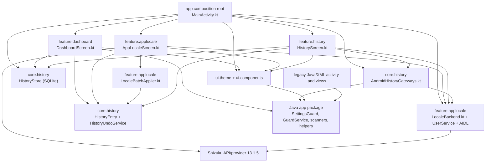

# Architecture audit

## P4.5 implementation delta (current source state)

The remainder of this audit records the P4 snapshot. The following source changes
supersede its outdated coupling findings:

- `feature.dashboard` now depends on `FcmGuardPlatform` / `FcmGuardController`;
  Java FCM interop is concentrated in `platform.fcm.JavaFcmPlatformAdapter`.
- History UI receives `HistoryRepository` and `HistoryUndoService`; it no longer
  constructs Android gateways or a Shizuku backend.
- `core.locale` defines the backend/repository contracts. Shizuku, AIDL,
  UserService, and the command adapter are under `platform.applocale`.
- The Shizuku permission lifecycle is no longer imported by the locale screen.
- History uses SQLite schema v4, atomic durable Undo claims, process-owner recovery,
  target-key locks, read/compare/read-back, inverse records, and guarded
  compensation. These are reliability improvements, not atomic system writes.
- `:app` remains the only Gradle module. Package separation is not Gradle
  modularity.
- P4.5 validation executed 29 JVM tests (0 failures), built the debug and
  instrumentation APKs, and completed lint with 0 errors and 56 warnings.
  Four Android instrumentation tests compiled but were not run because no
  connected device/emulator or `adb` executable is available in this environment.

The current dependency direction is summarized in
[`DEPENDENCY_GRAPH.md`](./DEPENDENCY_GRAPH.md). New contracts and risks are
documented in [`FCM_ADAPTER_CONTRACTS.md`](./FCM_ADAPTER_CONTRACTS.md),
[`HISTORY_RELIABILITY.md`](./HISTORY_RELIABILITY.md), and
[`LOCALE_BACKEND_COMPATIBILITY.md`](./LOCALE_BACKEND_COMPATIBILITY.md).

## P5 authoritative status

The P4 findings below are retained as historical audit evidence; where they
conflict with this section or the P5 deliverables, this section is authoritative.
P5 source review confirms:

- Dashboard feature code uses Kotlin FCM contracts/controller; Java FCM interop is
  through `platform.fcm.JavaFcmPlatformAdapter`. The P5 change also propagates the
  existing reconnect dispatch boolean so failed dispatch is not presented as
  accepted. This does not prove that GMS received or acted on a broadcast.
- Locale UI and orchestration use `AppLocaleRepository` and
  `PrivilegedLocaleBackend`; Shizuku and AIDL remain platform implementation
  details. Installed-app enumeration still uses Android `PackageManager` in the
  feature. The backend still uses the unstable `cmd locale` interface.
- History uses SQLite schema v4, a durable per-entry claim, process-local keyed
  target locks, external-state compare/read-back, inverse records, and guarded
  compensation. External system writes are not atomic with SQLite; races with
  unrelated external writers remain.
- `settings.gradle` still includes only `:app`. Package boundaries do not provide
  independent compilation or optional dependency removal.
- P5 added one controller test, one target-lock concurrency test, and one Android
  SQLite transaction instrumentation test. The instrumentation test compiles but
  was not run. See [`P5_VALIDATION_REPORT.md`](./P5_VALIDATION_REPORT.md) for
  executed counts and build/lint outcomes.
- The project is **not device-validated**. Service/boot/WRITE_SETTINGS,
  HyperOS/MIUI AppOps, Shizuku Binder, command compatibility, and actual app
  upgrade behavior require device evidence. The signing key in this checkout does
  not establish compatibility with an installed predecessor.

The final P5 modularization gate is recorded in
[`P5_MODULARIZATION_READINESS.md`](./P5_MODULARIZATION_READINESS.md), with
regressions and device checks in
[`P5_REGRESSION_MATRIX.md`](./P5_REGRESSION_MATRIX.md) and
[`P5_DEVICE_TEST_CHECKLIST.md`](./P5_DEVICE_TEST_CHECKLIST.md).

## Historical P4 source audit (superseded where noted above)

**Audit date:** 2026-11-11  
**Scope:** Current working tree after the Compose, history/undo, and app-locale work. This is a source audit, not a device certification.

## Executive assessment

**Overall: package-organized, not yet modular.** The project has one Gradle Android application module (`:app`). Kotlin packages group the dashboard, history, locale, design tokens, and history persistence, but the code still compiles and ships as one unit. Some seams are useful (history repository and locale backend interfaces); concrete Android, storage, and Shizuku types still cross those seams.

| Area | Assessment |
|---|---|
| Gradle modularity | **Low** — `settings.gradle` includes only `:app`. |
| Package organization | **Moderate** — recognizable feature packages, but one direct package dependency cycle. |
| Domain isolation | **Low to moderate** — several pure Kotlin use cases exist, but "core" also contains Android storage and platform gateways. |
| Feature replaceability | **Partial** — locale backend interface and history repository interface exist, but UI and composition-root code use concrete implementations. |
| UI/design-system isolation | **Low to moderate** — theme is centralized; screens use Material 3 directly and duplicate styling values. |
| Automated verification | **Limited but green** — 8 unit tests executed and passed; instrumentation APK compiled, but the instrumentation test was not run. |
| Device validation | **None in this environment** — `adb` is unavailable; no Shizuku, Sui, or HyperOS device was tested. |

No source implementation was rewritten in this audit. Four documents were added: this audit, the observed dependency graph, a staged modularization roadmap, and a device-validation plan.

## Baseline and existing state

- The working tree was already modified before the audit. Existing README, Gradle, manifest, Java activity/settings, Kotlin/Compose, AIDL, resources, tests, and wrapper changes were preserved.
- `git diff --check` passed at the baseline.
- `:app:testDebugUnitTest`, `:app:assembleDebug`, `:app:assembleDebugAndroidTest`, and `:app:lintDebug` completed successfully at the baseline.
- A forced test rerun (`--rerun-tasks :app:testDebugUnitTest`) executed **8 tests across 3 suites; 0 failures, 0 errors, 0 skipped**.
- The lint text report contained **0 errors and 56 warnings**. Examples include reflective access to MIUI AppOps in `AutostartStatusReader`, legacy-target API diagnostics, and a manifest `tools:replace` with no matching declaration. The project intentionally keeps `targetSdk 22`; do not treat the target-SDK warning as authorization to change it.
- The Android instrumentation APK compiled. The sole persistence instrumentation test was **not run**. `adb` is not installed in the current WSL environment.
- Gradle configuration is still a single `:app` project; there is no version catalog alias for feature-specific source sets or module boundaries.

## Current architecture

The graph reflects observed source imports and constructor wiring. It is not a proposed dependency direction. In particular, `core.history.AndroidHistoryGateways.kt` imports `feature.applocale.AppLocaleBackend`, while locale UI/orchestration imports history contracts. That creates a **package-level cycle** (`core.history` ↔ `feature.applocale`) even though no Gradle cycle is visible yet.

## Boundary findings

### Direct feature and platform coupling

1. `AppLocaleScreen.kt` imports `rikka.shizuku.Shizuku` to install the permission-result listener and uses `ShizukuLocaleBackend.REQUEST_CODE`. Replacing the backend therefore requires editing the UI, not only its implementation.
2. `AndroidHistoryGateways.kt` in `core.history` imports `feature.applocale.AppLocaleBackend`. A core package should depend on a locale port, not a feature implementation/interface package.
3. `HistoryScreen.kt` receives the concrete Android `HistoryStore`, constructs `AndroidSettingsGuardPort` and `BackendLocaleHistoryGateway`, and creates `HistoryUndoService`. It owns storage wiring and use-case construction as well as rendering.
4. `DashboardScreen.kt` depends directly on Java static APIs (`SettingsGuard`, `GuardService`, `FcmReconnect`, `FcmAppScanner`, `AutostartStatusReader`, `HyperOsSettings`, `LocaleHelper`, `ThemeHelper`) and concrete `HistoryStore`. There is no dashboard domain-facing control port that would permit replacing these adapters without changing the screen.
5. `MainActivity.kt` is a composition root, but also owns locale-history tracking and service startup. It directly selects `ShizukuLocaleBackend` and `HistoryStore`.
6. `GuardTheme.kt` depends on Java `ThemeHelper`, so presentation theme policy is coupled to legacy preferences.

### Framework and storage leakage

- `HistoryEntry`, `HistoryChange`, `HistoryUndoService`, `UndoPolicy`, and `LocaleBatchApplier` are mostly plain Kotlin and can be unit tested without Android.
- The same `core.history` package also contains `SQLiteOpenHelper` persistence and Android context/service/settings gateways. The package name therefore overstates the purity of the domain boundary.
- `DashboardScreen.kt` reads `Settings.System.canWrite` directly, outside the Java `SettingsGuard` adapter.
- `AppLocaleScreen.kt` enumerates applications via `PackageManager`; this is reasonable Android presentation/data access, but there is no catalog port for testing or replacing the package-list source.
- SQLite is not accessed via SQL statements directly in the screen, but the screen depends on the concrete store and invokes its query method. This is storage coupling at the UI boundary.
- Compose imports are confined to the app shell, feature screens, and UI packages. No Compose imports were found in the history policy/use case or locale batch applier.
- Shizuku imports occur in the locale backend and **also** the locale screen. The dependency is declared at the app module level, so it remains on the app compile/runtime graph regardless of whether a user opens the feature.
- Existing Java platform classes expose static methods and shared preferences directly. There is no Kotlin adapter boundary for dashboard operations.

### Shared models, duplicate logic, and global coupling

- `HistoryChange`, `HistoryEntry`, and history operation strings form a cross-feature contract but live with history implementation code.
- `AppLocaleBackend`, `LocaleBackendStatus`, and `SYSTEM_DEFAULT` are feature-package contracts mixed in the same file/package with the Shizuku adapter.
- `HistoryUndoService` dispatches operations using string constants. An enum/sealed operation model would make unsupported operations and serialization/migration handling explicit.
- Locale syntax validation is repeated in `LocaleBatchApplier` and `AppLocaleUserService`; package-name validation is repeated in the app backend and UserService. One shared pure validator/contract would reduce drift.
- Java utility classes (`SettingsGuard`, `LocaleHelper`, `ThemeHelper`, etc.) are static entry points backed by preferences/framework state. Shizuku itself is a static API. There is no app-wide Kotlin singleton, but global/static coupling remains in adapters.
- `GuardComponents.kt` nests `GuardStatusIndicator`, `GuardListRow`, and `GuardConfirmDialog` inside `GuardStatusRow`; they are local functions and cannot serve as reusable top-level components. This is an organization defect, not a runtime failure.

## Replaceability assessment

Scores describe the current source, not a desired future design.

| Scenario | Score | Evidence and files likely to change |
|---|---|---|
| A. Replace App Locale UI, keep backend | **Partially coupled** | Replace `AppLocaleScreen.kt`, but it also implements Shizuku permission listeners and references `ShizukuLocaleBackend.REQUEST_CODE`; retain or reproduce that behavior. `MainActivity.kt` owns tab routing and passes the backend/history directly. |
| B. Replace Shizuku backend, keep UI | **Partially coupled** | `AppLocaleBackend` is a useful seam, but update `AppLocaleScreen.kt` (Shizuku permission listener, request code, Shizuku wording/setup), `LocaleBackend.kt`, `MainActivity.kt`, `AndroidHistoryGateways.kt`, manifest provider, AIDL/UserService files, and `app/build.gradle` / version catalog. |
| C. Replace SQLite, keep History UI | **Partially coupled** | `HistoryRepository` already exists, but `HistoryScreen.kt` takes `HistoryStore`; `DashboardScreen.kt` and `MainActivity.kt` also take/create the concrete store. Change those signatures/composition wiring to the repository/use-case API, then swap `HistoryStore.kt`. |
| D. Replace Material 3 design system, keep business logic | **Partially coupled** | Business logic is not implemented in the theme, but `DashboardScreen.kt`, `AppLocaleScreen.kt`, and `HistoryScreen.kt` directly use Material 3 widgets and scattered colors/spacings. `GuardTheme.kt` and `GuardComponents.kt` are not yet a complete façade. |
| E. Remove App Locale feature without affecting FCM | **Partially coupled** | Core FCM behavior does not call Shizuku, but remove/update `MainActivity.kt`, `HistoryScreen.kt`, `HistoryUndoService.kt` locale operations, `AndroidHistoryGateways.kt`, history locale contracts, app-locale history rows/presentation, manifest/resources, and dependency declarations. |
| F. Remove Shizuku support without affecting core FCM | **Partially coupled** | FCM runtime is not Shizuku-dependent, but the app shell and History feature expect a locale backend. Remove Shizuku imports/provider/dependencies and either retain an unsupported backend or remove/disable locale screens and undo operations. |
| G. Replace Java FCM adapters with Kotlin, keep feature screens | **Tightly coupled** | `DashboardScreen.kt` calls concrete Java statics and nested scanner/status types; `MainActivity.kt`, `GuardTheme.kt`, and history adapters also reference Java utilities. Introduce stable ports and Kotlin adapter implementations before moving/replacing the Java classes. |

## History and Undo correctness audit

### Sound parts

- SQLite schema version is 2. Creation makes a history table plus timestamp and batch indexes. `onUpgrade` includes the v1→v2 `batch_id` migration.
- `recordAll` filters no-ops and inserts entries in a database transaction. `recordUndo` inserts its inverse and marks the original non-reversible in one SQLite transaction.
- Undo reads the current state and compares it with `newValue`; a mismatch returns `Conflict` before writing. It reads back after applying and records the inverse only after a successful matching verification.
- If persistence of a successful undo throws, the use case attempts to restore the pre-undo state and verify that compensation.
- Batch undo is deliberately per-entry, not all-or-nothing. It processes only reversible entries, counts success/conflict/failure separately, and does not undo a conflicting item.
- Locale batch execution processes sequentially, checks cancellation between apps, verifies each change by backend read-back, records each changed success independently, and continues after individual failures. This is suitable for partial results.
- Failure outcomes for locale operations can be stored as non-reversible history entries; no-op successes are not stored.

### Reliability gaps to address before calling Undo robust

1. **Read/compare/write is not atomic.** The platform value can change after `readCurrent()` and before `writeValue()`. Undo may then overwrite that newer value. Platform gateways provide no compare-and-set contract; the current pre-write comparison only detects conflicts present at read time.
2. **Concurrent Undo can race.** Two callers can both read the same after-value and both perform the platform write before either transaction consumes the original reversible flag. `recordUndo` protects the database row, but it does not reserve the entry before platform mutation. If the second transaction loses, compensation may restore the value it read and race with the first caller.
3. **Early verification failures are not compensated.** A false `writeValue`, an exception after a platform-side partial write, or a read-back mismatch returns `Failed` without attempting to restore the original current value. The original entry remains reversible even if the external state partially changed.
4. **Batch Undo is not a transaction across platform operations.** This is acceptable for partial batch semantics but must remain presented as per-item outcomes; earlier successes stay applied when a later item conflicts/fails.
5. **History order is not total.** `recent()` sorts only by millisecond timestamp; multiple entries can share a timestamp. `forBatch()` also sorts only by timestamp ascending. A stable sequence/ID tie-breaker is advisable, especially for deterministic batch operations.
6. **Migration evidence is missing.** The v1→v2 migration is source-visible, but there is no migration fixture/test. The persistence instrumentation test only creates a fresh DB, closes/reopens it, and checks records.
7. **Backend-unavailable behavior is only partly covered.** Undo catches read/write exceptions and returns failure, but there is no test that exercises backend death/revocation or verifies no state/history corruption in those cases.
8. **Operation contract is stringly typed.** Existing rows can contain unsupported operation strings; they become failed Undo attempts. Schema evolution of operation names needs a migration/compatibility policy.

History is private local SQLite storage; this source does not encrypt it. The app manifest disables backup, so records are not expected to migrate through Android backup. The database is durable across ordinary process death by SQLite semantics, but the instrumentation evidence has not yet been executed on Android.

## Shizuku/Sui integration audit

### Source verification

- Version is centralized as `13.1.5` in `gradle/libs.versions.toml`; `api` and `provider` are implementation dependencies in `app/build.gradle`.
- Manifest declares the Shizuku provider with the documented authority/permission shape; resource qualifiers disable it on older Android versions. The manifest also has `tools:overrideLibrary` entries to preserve app minSdk 21 despite higher dependency min SDKs.
- `LocaleBackend.kt` uses Shizuku binder received/dead listeners, permission checking, `bindUserService`, and `unbindUserService`. It adapts the returned binder through AIDL.
- The isolated service implements the AIDL stub. The contract is narrow: read/set app locales and destroy. It validates package names and locale tags and passes an argument array to `Runtime.exec`, not an interpolated shell command string.
- The app checks Android API 33+ before constructing or using the supported backend. The user-service command also checks the OS version.
- The app-level `LocaleHelper` uses Android's `LocaleManager` for this application only. Other-app changes go through the privileged backend, not public `LocaleManager`.
- Batch results are read back before being reported successful. Failures are retained for individual retry; cancellation is between apps, not an interrupt of an in-progress Binder/command operation.

The official [Shizuku API guide](https://github.com/RikkaApps/Shizuku-API) documents this UserService/AIDL pattern, Binder lifecycle callbacks, and that UserService code runs as root (UID 0) or shell (UID 2000), depending on how the service was started. It also documents that Shizuku requires setup and, for non-root Shizuku, restart after reboot. The implementation uses `destroy()` and process termination, consistent with the guide's requirement to clean up/terminate the UserService process.

Android's [per-app language documentation](https://developer.android.com/guide/topics/resources/app-languages) describes public `LocaleManager` APIs as app-level language preference APIs. It does not provide a public API for an ordinary app to change a different app's locale; this implementation therefore uses a privileged shell service for that operation.

### Compatibility and operational risks

- **Shell command is not an SDK contract.** `cmd locale get-app-locales` / `set-app-locales`, its option order, output wording (`Locales for ... are [...]`), and reset representation are relied upon. The code does not pin or test command parsing against Android release source/runtime matrices. The audit could verify public Android API guidance and Shizuku UserService docs, but could not verify this shell command's response format against an attached Android build. Treat OEM and future Android compatibility as unverified.
- **Privilege level is not surfaced or validated.** The code does not call `Shizuku.getUid()` or distinguish shell from root. A shell-started Shizuku and root-backed Sui can have different capabilities; command failures are the current capability signal.
- **Binder/UserService recovery is incomplete.** Shizuku binder death clears state and allows a later connect; `onServiceDisconnected` is handled. There is no explicit `onBindingDied`/null-binding path or UserService-specific death recipient/error classification. Permission revocation makes calls fail/status change, but recovery must be triggered by UI/resume rather than a dedicated permission callback.
- **Permission rationale and pre-v11 handling are absent.** Current dependency is 13.1.5, so pre-v11 support is not expected, but the UI does not distinguish an unsupported Shizuku server version from general service unavailability.
- **User ID selection is assumed.** `Process.myUid() / 100000` derives the Android user from this app's UID. Work profiles, secondary users, user switching, and vendor command behavior need physical verification; the UI has no explicit user selector.
- **Provider and override brittleness.** The Shizuku provider and forced manifest library override are app-wide. The current manifest merge reports a `tools:replace` warning because there is no declaration to replace in this dependency graph.
- **Command execution lifecycle.** `waitFor(timeout)` precedes draining stdout/stderr. Current command output should be small, but a full pipe could block before timeout handling. Consider concurrent stream draining and explicit process cancellation in a backend hardening phase.
- **No feature tests exercise AIDL, Shizuku permission, Binder death, root/shell capability, command syntax, or locale read-back on a device.** The fake backend tests only the batch coordinator.
- **No OEM guarantee.** Xiaomi/HyperOS and other ROM behavior is untested. Setting a locale also cannot provide translations absent from the target app's resources.

## Material 3 and frontend audit

### Good foundations

- `GuardTheme.kt` centralizes light/dark fallback palettes and Android 12+ dynamic color selection.
- `MainActivity.kt` enables edge-to-edge and uses `WindowInsets.safeDrawing`; the system-bar XML values are API-qualified.
- The app uses Compose for the launcher path. `MainActivityLegacy` and old XML resources remain in the source tree but are not the manifest launcher.
- The three-screen navigation is small and explicit; the selected tab uses `rememberSaveable`.
- Slow FCM scan/package enumeration and locale operations are moved to IO dispatchers.

### Remaining gaps

- Typography and shapes are Material defaults (`Typography()`, `Shapes()`), not project-specific tokens. Spacing is partly centralized, but screens still contain hard-coded dp, padding, colors, and direct `Card`/`Button`/`Switch` usage.
- `GuardComponents.kt` is not a reliable component façade: some intended reusable composables are local nested functions, and screens directly implement their own Material components.
- The dashboard is a 696-line composable; locale and history screens are 401 and 250 lines. Each owns UI state, platform calls, orchestration, errors, and callbacks. There are no ViewModels or independently tested presentation state holders.
- State is managed with `remember`/`LaunchedEffect`; there are no `Flow`/`StateFlow` streams and no lifecycle-aware state collection. `onResume` manually refreshes a subset of state. Loading/error/empty states exist in scans, locale listing, and history, but the architecture does not establish a uniform state contract.
- `AppLocaleScreen` writes progress Compose state from a callback invoked inside `withContext(Dispatchers.IO)`. Route progress through a main-dispatcher state update or a flow/channel.
- English strings are hard-coded throughout the Compose screens. Existing translated resources remain, but the new screens do not use them; language coverage and accessibility labels are incomplete.
- Bottom-navigation icons are letters (`D`, `A`, `H`) represented as text. Interactive controls need a screen-reader review; no Compose UI/accessibility tests exist.
- Default Material controls inherit font scaling, but large-font, narrow-width, RTL, contrast, TalkBack, and touch-target behavior has not been tested.
- There are no explicit transition/animation policies. Dynamic colors are present; appearance switching relies on `ThemeHelper` state changes and recomposition in the dashboard.

## Test evidence and missing assurance

| Concern | Actual evidence |
|---|---|
| Undo policy | 2 executed JVM tests: matching after-value is safe; non-reversible entry is not. |
| Undo service | 3 executed JVM fake-based tests: conflict leaves value/history untouched, safe undo writes/verifies/inverts, batch skips conflicts. No concurrent race or platform failure compensation test. |
| Locale batch logic | 3 executed JVM fake-backend tests: records success/failure outcomes, continues after failure, cancellation boundary, excludes system app. Does not test Shizuku or real commands. |
| SQLite persistence | 1 Android instrumentation test is present and compiled. It was **not executed** on an Android runtime. |
| SQLite migration | No migration test/fixture. |
| FCM behavior | No JVM/unit or instrumentation regression tests found for `SettingsGuard`, repair/no-op/package preservation, reconnect conditions, GuardService, BootReceiver, FCM scan, or HyperOS autostart. |
| UI behavior | No Compose UI tests found. |
| Device hardware | No attached adb device; Shizuku/Sui and HyperOS unverified. |

### Key source references

- App wiring: [MainActivity.kt](../app/src/main/java/com/reed/fcmguard/MainActivity.kt)
- Dashboard/platform calls: [DashboardScreen.kt](../app/src/main/java/com/reed/fcmguard/feature/dashboard/DashboardScreen.kt)
- History storage: [HistoryStore.kt](../app/src/main/java/com/reed/fcmguard/core/history/HistoryStore.kt)
- Undo policy/use case: [HistoryUndoService.kt](../app/src/main/java/com/reed/fcmguard/core/history/HistoryUndoService.kt)
- Android gateways: [AndroidHistoryGateways.kt](../app/src/main/java/com/reed/fcmguard/core/history/AndroidHistoryGateways.kt)
- Locale UI and backend: [AppLocaleScreen.kt](../app/src/main/java/com/reed/fcmguard/feature/applocale/AppLocaleScreen.kt), [LocaleBackend.kt](../app/src/main/java/com/reed/fcmguard/feature/applocale/LocaleBackend.kt), [AppLocaleUserService.kt](../app/src/main/java/com/reed/fcmguard/feature/applocale/AppLocaleUserService.kt)
- Theme/components: [GuardTheme.kt](../app/src/main/java/com/reed/fcmguard/ui/theme/GuardTheme.kt), [GuardComponents.kt](../app/src/main/java/com/reed/fcmguard/ui/components/GuardComponents.kt)
- Current project boundary: [settings.gradle](../settings.gradle), [app/build.gradle](../app/build.gradle)
