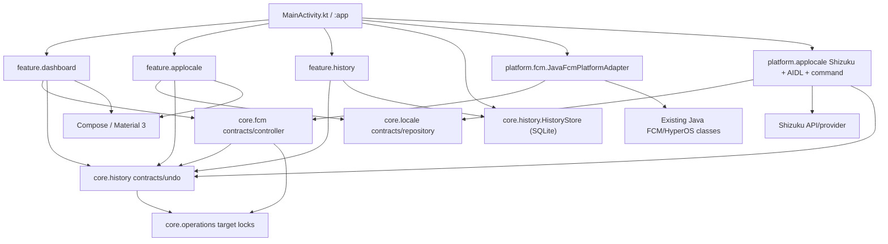
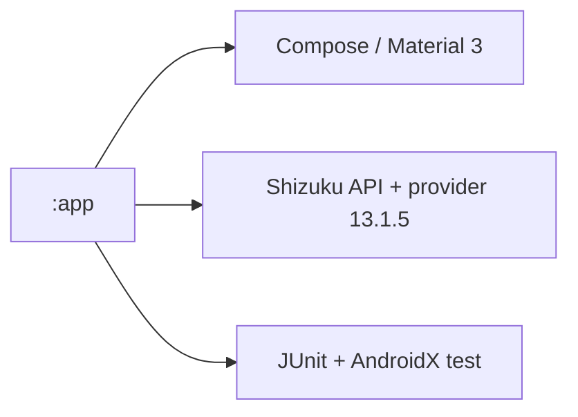
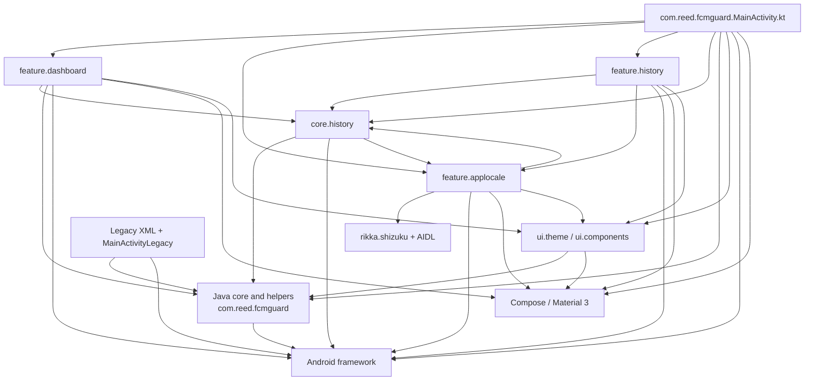

# Observed source dependency graph

## P4.5 current graph update

The graph below records the P4 baseline. The current source graph after P4.5
boundary changes is:



The current UI packages have no imports of concrete Java FCM classes or Shizuku
types. The locale feature still imports Android package-manager APIs for installed
app enumeration, and Compose screens still use the Material 3 API directly. The
`HistoryStore` implementation remains in `core.history` and uses Android SQLite;
package names therefore do not yet correspond to clean Gradle/domain modules.
`MainActivity` selects and constructs concrete platform implementations by design.

### Current source-edge evidence

| From | To | Evidence / qualification |
|---|---|---|
| `MainActivity.kt` | Dashboard, locale, history, SQLite store, Java FCM adapter, Shizuku locale adapter, design system | Composition root selects concrete implementations and supplies contracts. |
| Dashboard feature | `core.fcm`, history contracts, Compose/Material 3 | Feature uses Kotlin controller/port; P5 reconnect outcome also propagates adapter dispatch acceptance. |
| FCM platform adapter | Existing Java FCM/HyperOS classes | `JavaFcmPlatformAdapter.kt` is the Kotlin↔Java implementation boundary. |
| App-locale feature | `core.locale`, history contracts, `PackageManager`, Compose/Material 3 | No Shizuku imports in the feature; package catalog remains Android-framework coupled. |
| Locale platform | `core.locale`, Shizuku API, AIDL UserService, `cmd locale` | Binder lifecycle and privileged command execution are platform-specific; shell protocol remains unstable. |
| History feature | `core.history` contracts/store and Compose/Material 3 | The feature depends on repository/use-case seams, but the data implementation still lives in the same package and module. |
| History implementation | Android SQLite, FCM settings port, locale repository/port | SQLite and Android gateway implementations remain in `core.history`; module/domain purity is incomplete. |
| Design system | Compose/Material 3 and legacy theme preference adapter | Components centralize some tokens but feature screens directly use Material 3 APIs. |
| Java platform classes | Android framework and app resources | Service/receiver/settings integration remains in the Java app package and manifest. |

This source graph has no Shizuku dependency in the normal FCM feature path and no
feature import of concrete Java FCM classes. It is still one Gradle module, and
the feature-level PackageManager/Material 3 dependencies mean the replaceability
seams are incomplete.

**Audit date:** 2026-11-11  
This graph is derived from source imports and actual constructor wiring. It describes the current single `:app` module, not a recommended architecture.

## Historical P4 graph and findings — superseded

The diagrams and edge table below preserve the original P4 snapshot for audit
history only. In particular, claims below that the dashboard imports concrete
Java classes, the locale screen imports Shizuku, or a feature↔core cycle exists
describe pre-P4.5 source and are not current. Use the P4.5 graph and current
source-edge evidence above.

## Current Gradle graph



`settings.gradle` includes only `:app`. No source package is independently compiled, tested, disabled, or dependency-constrained as a Gradle module.

## Actual source/package graph



## Evidence for direct edges

| From | To | Source evidence |
|---|---|---|
| App shell | Dashboard, App Locale, History, theme, HistoryStore, Shizuku backend | `MainActivity.kt` imports/constructs these and switches among their composables. |
| Dashboard | Java FCM/config/locale/theme helpers and Android Settings, concrete HistoryStore | `DashboardScreen.kt` imports static Java classes, reads `Settings.System.canWrite`, and records directly to the store. |
| App Locale UI | Shizuku, locale backend, history recorder, package manager, Compose | `AppLocaleScreen.kt` imports `rikka.shizuku.Shizuku`, registers a Shizuku permission listener, loads apps through `PackageManager`, and invokes `LocaleBatchApplier`. |
| Locale orchestration | History and locale backend contract | `LocaleBatchApplier.kt` imports `HistoryChange`, `HistoryRecorder`, and `AppLocaleBackend`. |
| Locale backend | Shizuku API, Android service/binder, AIDL UserService | `LocaleBackend.kt` imports `rikka.shizuku.Shizuku`; `AppLocaleUserService.kt` extends the generated AIDL stub. |
| History UI | Concrete SQLite store, history use case, Android gateways, locale backend | `HistoryScreen.kt` accepts `HistoryStore` and `AppLocaleBackend`, creates concrete gateway/use-case instances, and calls the store. |
| `core.history` | Android and FCM Java core | `HistoryStore.kt` extends `SQLiteOpenHelper`; `AndroidHistoryGateways.kt` uses `SettingsGuard`, `GuardService`, `LocaleHelper`, and Android `Context`. |
| `core.history` → App Locale | Feature-package contract | `AndroidHistoryGateways.kt` imports `feature.applocale.AppLocaleBackend` to implement `BackendLocaleHistoryGateway`. |
| UI design | Java theme helper and Compose | `GuardTheme.kt` calls `ThemeHelper`; `GuardComponents.kt` imports Material 3 and `GuardSpacing`. |
| Java core | Android framework | `SettingsGuard`, `GuardService`, `BootReceiver`, scanners and platform helpers are Android framework classes/services. |

## Cycle and coupling points

The source package graph has this cycle:

```text
feature.applocale -> core.history
    (screen and LocaleBatchApplier depend on HistoryRecorder/HistoryChange)
core.history -> feature.applocale
    (AndroidHistoryGateways depends on AppLocaleBackend)
```

The dependency should be inverted by moving locale and history ports/models to a neutral `core.domain` API. Implementations should depend on those contracts; features should not be imported by `core`.

Other high-impact concrete edges:

- `feature.dashboard -> Java core` rather than a dashboard-facing interface.
- `feature.history -> HistoryStore` rather than repository/use-case injection.
- `feature.history -> AppLocaleBackend` and concrete gateway construction.
- `feature.applocale UI -> Shizuku`, which prevents replacing the provider/backend in isolation.
- `ui.theme -> ThemeHelper`, which couples design-system code to legacy preference storage.
- `:app -> Shizuku` because all implementation dependencies are declared in `app/build.gradle`.

## Not present in the current graph

- No ViewModel/state-holder module or lifecycle-aware flow boundary.
- No Room dependency; persistence is SQLiteOpenHelper.
- No Gradle feature or platform subprojects.
- No FCM domain/service interface between Compose and Java platform code.
- No test-only fake around Java FCM platform APIs.
- No direct Compose dependency from `HistoryUndoService`, `HistoryEntry`, or `LocaleBatchApplier`.
