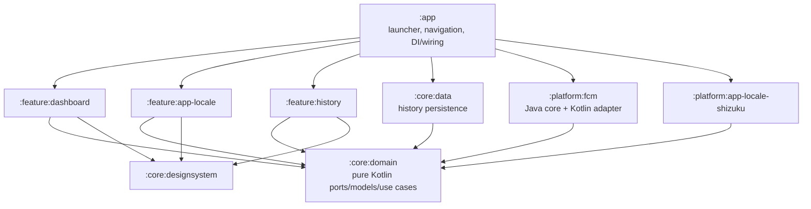

# Modularization roadmap

**Status:** P5 audit complete; no Gradle module extraction has been performed.
The P4.5 package/API boundaries exist, but P5 recommends **NO-GO for broad
extraction** until device, signing/upgrade, and instrumentation gates pass. See
[`P5_MODULARIZATION_READINESS.md`](./P5_MODULARIZATION_READINESS.md) for the
authoritative readiness and P6 entry criteria. The proposal below is not a claim
that the listed modules exist.

## Completed P4.5 boundary work

- Dashboard behavior now consumes Kotlin `FcmGuardPlatform` / controller
  contracts, with existing Java interop in a platform adapter.
- History UI receives repository and Undo service APIs rather than constructing
  Android gateways.
- Shizuku API, UserService, AIDL, and command parsing are isolated in
  `platform.applocale`; feature UI depends on locale contracts.
- SQLite schema v4 tracks pending/interrupted Undo and uses transactional state
  transitions plus optimistic external-state checks.
- Tests cover core controller decisions, locale command parsing/verification,
  batch partial success, conflicts, and Undo concurrency/failures.

These are package-level seams only. `settings.gradle` still includes only `:app`;
HistoryStore is Android data code in `core.history`, and the screens remain in the
same compilation unit as all platform implementations.

## P5 gate result

- The FCM Java adapter and locale backend seams are useful package boundaries,
  not independently buildable modules.
- The reconnect helper's boolean dispatch outcome is now visible to the controller
  and UI. Its meaning is limited to local dispatch acceptance.
- History claims/locks and the new concurrency tests improve same-process behavior;
  Android SQLite transaction/migration instrumentation remains compile-only.
- Locale shell output draining is bounded and concurrent with process execution,
  but `cmd locale` is still not a stable SDK contract and no API/ROM was device
  verified.
- No APK upgrade/signing compatibility is established from the local ignored
  debug keystore.

Do not treat the ordered extraction phases below as completed. P5's next proposed
step is a single `:core:domain` pilot only after the P6 entry gates pass.

## Design constraints

- Preserve the existing `targetSdk 22`, `WRITE_SETTINGS` compatibility behavior, FCM repair semantics, and Java platform implementation until a tested adapter replacement exists.
- Move one boundary at a time; make each module real by migrating implementation/tests before adding another module.
- Keep dependency direction one-way: app composition root → features/adapters; features → domain contracts/design system; data/platform adapters → domain contracts.
- Do not let `core.domain` depend on Android, Compose, SQLite, Shizuku, Java FCM implementation classes, or feature UI packages.
- Keep Shizuku optional from the core-FCM runtime path.

## Smallest useful long-term module set

This is the smallest set that creates meaningful replacement seams for the requested feature/platform boundaries. It is not a prescription to create empty modules immediately.

Arrows are compile-time dependencies. The app supplies implementations to feature constructors/factories. Features do not depend on platform implementations; platform adapters do not depend on features.

## Proposed module contracts

| Module | Responsibility and public API | Allowed dependencies | Forbidden dependencies | Existing files to migrate |
|---|---|---|---|---|
| `:core:domain` (Kotlin/JVM) | Pure models and ports: typed history operation/change/result, repository interface, history Undo use case, locale backend/catalog contracts, guard control contracts, batch policy/result. | Kotlin/JDK only; optional pure test libraries. | Android, Compose, SQLite, Shizuku, `com.reed.fcmguard` Java implementation, any feature module. | `HistoryEntry.kt`, the policy/use-case portions of `HistoryUndoService.kt`, and the pure batch logic from `LocaleBatchApplier.kt`; move `LocaleApp`/contracts to domain. |
| `:core:data` (Android library) | History repository implementation, schema/migrations/transactions, Android DB tests. Publicly implements domain repository; no DB type leaks. | `:core:domain`, Android/SQLite APIs. | Compose, Shizuku, dashboard/history/app-locale features, FCM implementation. | `HistoryStore.kt`; keep the existing repository interface in domain. Move DB-specific Android test here. |
| `:core:designsystem` (Android library) | Material 3 theme, tokens, reusable components and typography/shape/color API. | Compose UI/Material 3, Android dynamic color APIs. | Feature business logic, history/FCM/platform adapters, Shizuku. | `ui/theme/GuardTheme.kt`, `ui/components/GuardComponents.kt`; remove `ThemeHelper` dependency through injected theme preference or app-level theme selection. |
| `:platform:fcm` (Android library) | Existing Java FCM and HyperOS integrations behind Kotlin interfaces. Expose status, repair, scanner, service lifecycle, settings/config ports; preserve behavior. | `:core:domain`, Android SDK, own platform resources. | Compose, app-locale feature, Shizuku, history UI. | `SettingsGuard.java`, `GuardService.java`, `BootReceiver.java`, `FcmReconnect.java`, `FcmAppScanner.java`, `AutostartStatusReader.java`, `HyperOsSettings.java`; leave XML/activity-only views in `:app`. Add Kotlin ports/adapters. |
| `:platform:app-locale-shizuku` (Android library) | Shizuku/Sui provider, permission/session lifecycle, AIDL UserService and privileged command implementation. Implements domain locale backend; contains no Compose. | `:core:domain`, Shizuku API/provider, Android/AIDL. | Feature composables, history database implementation, FCM implementation. | `LocaleBackend.kt` (Shizuku and unsupported implementations), `AppLocaleUserService.kt`, AIDL, Shizuku manifest/provider and qualified resources. |
| `:feature:dashboard` (Android library) | Dashboard presentation/state holder; invoke injected guard/scanner/appearance contracts. | `:core:domain`, `:core:designsystem`, Compose, Android lifecycle/UI. | Java implementation classes, SQLite implementation, Shizuku. | `DashboardScreen.kt`; replace direct Java static calls with injected ports and split scan, protection, config, appearance presentations. |
| `:feature:app-locale` (Android library) | App catalog/search/select/preview/progress/retry UI and locale orchestration over domain interfaces. | `:core:domain`, `:core:designsystem`, Compose, Android PackageManager for catalog port implementation. | Shizuku API/provider and UserService classes; concrete history DB. | `AppLocaleScreen.kt`; move installed-app enumeration behind a port; move `LocaleBatchApplier` policy to domain and UI state handling to a state holder. |
| `:feature:history` (Android library) | Timeline/detail/confirmation UI over history read/undo state contracts. | `:core:domain`, `:core:designsystem`, Compose. | `HistoryStore`, SQLite types, Java FCM classes, Shizuku API/concrete locale backend. | `HistoryScreen.kt`; remove store and gateway construction from the composable. |
| `:app` (Android application) | Manifest/launcher/navigation, selected implementation wiring, optional feature composition, app-level settings/resources. | All selected features, data, and platform implementation modules. | No reverse dependency from libraries. | `MainActivity.kt`; keep Activity lifecycle and wiring small. `MainActivityLegacy` and its XML remain app-only until removed in a separately approved migration. |

## Ordered migration plan

### Phase 0 — Stabilize behavior and contracts

1. Add targeted tests for Undo failures, race behavior, migration, and Java FCM invariants before moving classes.
2. Define typed operation identifiers and explicit port contracts while still in `:app`; retain stored operation-string compatibility.
3. Document Shizuku command support per tested Android/API build and capture real command outputs in device tests. Do not claim support based only on shell command compilation.

**Exit:** existing unit tests plus new regression tests pass; no changes to `targetSdk` or WRITE_SETTINGS path.

### Phase 1 — Extract `:core:domain`

1. Move pure history entities/policy/use cases and locale batch policy/contracts.
2. Move `AppLocaleBackend` contract and status types out of the feature implementation package.
3. Replace the `core.history` ↔ `feature.applocale` cycle with domain ports.
4. Compile `:core:domain` as Kotlin/JVM with tests that do not load Android.

**Exit:** dependency graph is acyclic; no Android/Compose/Shizuku imports in `:core:domain`.

### Phase 2 — Extract data and privileged platform adapters

1. Move `HistoryStore` into `:core:data`; make UI and features depend only on a repository/use-case API.
2. Move Shizuku classes/AIDL/provider to `:platform:app-locale-shizuku`; remove the Shizuku import and permission callback from locale UI.
3. Add fake-backend tests for error, permission revocation, Binder death, null binding, and reconnect state transitions.
4. Keep unsupported-platform behavior as a domain-compatible backend selected by app wiring.

**Exit:** build without Shizuku implementation can still compile core dashboard/history; locale UI is backend-agnostic.

### Phase 3 — Extract features/design system

1. Extract `:core:designsystem` and make all feature components use tokens rather than raw theme values.
2. Extract history and locale screens as independent feature libraries.
3. Introduce a dashboard port before moving/replacing Java classes.
4. Split the dashboard composable into focused screen sections/state holders without changing FCM behavior.

**Exit:** design-system replacement and feature-disable checks can be run by removing one module dependency at a time.

### Phase 4 — Extract `:platform:fcm` and Kotlin adapters

1. Define Kotlin interfaces for guard configuration/read/repair, service lifecycle, scanning, HyperOS status, and reconnect.
2. Wrap unchanged Java classes behind those interfaces; migrate Java classes only after parity tests.
3. Move the platform implementation into `:platform:fcm`, keeping app-specific XML/UI and resources in `:app`.
4. Verify legacy strings/resource IDs and manifest declarations during library migration.

**Exit:** dashboard and history feature sources contain no Java implementation imports, and core behavior tests pass against the Java-backed adapter.

### Phase 5 — Enforce and continuously verify direction

- Add lightweight architecture tests or dependency rules to prevent `core.domain -> Android`, `core -> feature`, `feature -> platform implementation`, and `designsystem -> feature` edges.
- Add module-level test tasks to CI. Do not add a framework solely for a small app; Gradle dependency checks or simple module/API compilation checks may suffice.
- Run all device-validation gates in `DEVICE_VALIDATION_PLAN.md` before release claims.

## Migration risk register

| Risk | Mitigation |
|---|---|
| Moving `SettingsGuard` references/resources changes core behavior | Keep Java implementation intact initially; adapter parity tests must assert exact repair/no-op/preservation/reconnect semantics. |
| Android library resource namespace and manifest merge differ from app resources | Assign explicit namespaces; move only platform-owned resources; inspect merged manifest after each extraction. |
| History operation names already persisted as strings | Preserve old wire/storage names or provide explicit DB migration; test fixtures from previous schema. |
| `HistoryScreen` currently constructs gateways directly | Move construction to app composition root and pass use cases/read state interfaces. |
| Removing Shizuku provider accidentally affects FCM | Verify no Shizuku types/providers are required from dashboard/service modules; run a core-only build without locale adapter. |
| API minSdk overrides hide dependency restrictions | Keep minSdk 21 and provider qualifiers; validate manifest merge and install behavior on API 21/23/24 separately. |
| Large dashboard extraction changes callbacks and lifecycle | First extract interfaces while staying in `:app`; test operation result/permission/service callbacks before moving source files. |
